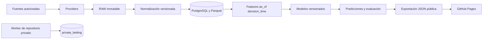

# Arquitectura

La especificación vigente es [docs/PROJECT_SPEC.md](docs/PROJECT_SPEC.md); el alcance comprobado está en [docs/IMPLEMENTATION_STATUS.md](docs/IMPLEMENTATION_STATUS.md).

## Componentes y flujo

El proyecto es un monolito Python modular. El dominio contiene reglas deportivas/temporales y contratos, sin importar endpoints de SofaScore o Betano. Las integraciones implementan providers y almacenamiento. GitHub Actions será el ejecutor por lotes; PostgreSQL y object storage conservan estado entre ejecuciones.

Foundation entrega contratos y mecanismos verificables. Fase 2 añade ingestión
manual mediante extensión, RAW, normalización de calendario y tracking en
PostgreSQL. Features deportivas, inferencia, recepción remota y publicación
permanecen pendientes.

## Responsabilidades

| Área | Responsabilidad |
| --- | --- |
| Dominio | Tiempo de disponibilidad, ciclos, mappings, odds/edge, elegibilidad, versionado |
| Providers | Convertir una fuente autorizada en observaciones con metadata; mantener los IDs externos fuera de la identidad interna |
| Storage | Conservar bytes inmutables y hashes; URI sin credenciales; implementación local para desarrollo |
| PostgreSQL | Relaciones, estados, constraints, idempotencia, locks y permisos |
| Registry/gobernanza | Vigencia de modelos/políticas, ventanas de evaluación y protección de holdout |
| Actions futuro | Orquestar jobs observables, reintentables e idempotentes |
| Publicación futura | Exportar exclusivamente contratos públicos versionados y desplegar Pages |

Las fuentes temporales pasan por `as_of(decision_time)` antes de convertirse en features. Los modelos no consultan tablas arbitrarias ni invocan providers directamente. El manifiesto de análisis liga RAW, versiones de adaptación/normalización/features, configuración, modelo, políticas y SHA.

## Límites de persistencia

PostgreSQL guarda información normalizada y operativa. Object storage guarda RAW, Parquet, datasets, artefactos, manifests y distribuciones voluminosas. Los snapshots constantes son observaciones diferentes aunque compartan bytes. GitHub no es la base de datos ni el almacén de backups.

Los adaptadores locales y fixtures permiten probar Foundation sin credenciales de terceros. El acceso real a Neon/R2 y las APIs se incorpora mediante configuración, preservando TLS, firmas y verificaciones de contenido. La arquitectura no presupone un endpoint no autorizado.

## Implementación de Foundation

| Ruta | Capacidad actual |
| --- | --- |
| `src/sports_analysis/domain/` | Contratos temporales, eventos/ciclos, runs/leases, mappings, mercados, paper y gobernanza |
| `src/sports_analysis/providers/` | Protocolos de las cuatro familias de fuente, provider offline y normalizador de estadísticas de fixtures |
| `src/sports_analysis/storage/` | Almacenamiento POSIX local inmutable, metadata RAW y manifests de inputs |
| `src/sports_analysis/db/` y `migrations/` | Runner transaccional, esquema PostgreSQL e integridad persistida |
| `config/` | Configuración versionada, con NO BET todavía en borrador |
| `tests/` | Casos sintéticos de invariantes y pruebas contra PostgreSQL temporal |
| `.github/workflows/ci.yml` | Validaciones sin secretos de producción |

El normalizador de fixtures demuestra RAW → NORMALIZED y produce registros con disponibilidad temporal; no interpreta respuestas reales de SofaScore. El manifiesto local `InputManifest` reúne capturas verificadas y versiones de pipeline/normalizador. El manifiesto completo de una predicción, con modelos, políticas y todas las versiones de features, se integrará cuando exista esa ejecución deportiva.

Las clases de dominio validan invariantes, pero no son servicios operativos. Un objeto Python de evidencia de desbloqueo no autentica a un administrador; un `EventLock` en memoria no reemplaza las funciones atómicas de PostgreSQL. Tampoco existe todavía almacenamiento de features deportivas o un builder de datasets históricos.

## Ejecución y recuperación

Un run analiza un ciclo y genera uno o más mercados/predicciones. La identidad de un cron usa su slot y la del manual su run ID de GitHub. La exclusión por ciclo reside en PostgreSQL con TTL; los propietarios antiguos no pueden actuar sobre un lock reasignado. Los huecos de scheduler quedan visibles y no se rellenan con datos retrospectivos presentados como observados.

Un reconciliador posterior detectará etapas sin heartbeat y marcará `FAILED_TIMEOUT`. La caída de un runner no debe dejar el ciclo bloqueado permanentemente. Cada publicación futura llevará versión del contrato, SHA y timestamps para identificar datos atrasados.

## Frontera pública y privada

El código público puede contener el esquema de las apuestas reales y pruebas sintéticas de permisos. Sus credenciales de runtime no pueden leer ese esquema. Los datos reales, el workflow de registro y su exportación viven en el futuro repositorio privado. La interfaz pública nunca envía stakes/precios tomados a Actions públicos.

El futuro frontend consume JSON estático; la sección privada, cuando exista, usa un token separado contra GitHub. La separación debe existir en SQL, workflows, almacenamiento y exportación, además de la interfaz visual.

## Evolución

Foundation se completa antes de construir calendario/tracking. Los modelos estadísticos preceden a GBM/redes y el sitio final se construye sobre contratos de datos comprobados. Las reglas de seguridad, tiempo e identidad de ciclos son invariantes de todas las fases. Las decisiones y ambigüedades se registran en [docs/decisions](docs/decisions).

## Provider manual del navegador

La extensión MV3 usa una pestaña y un panel lateral. Exporta únicamente una
observación de campos revisados; no comunica con PostgreSQL ni contiene secretos.
`providers/browser.py` valida y normaliza; `db/browser.py` aplica recibos,
identidades, ciclos y tracking; `browser_cli.py` expone la operación local.
Los objetos permanecen en el `ObjectStore` inmutable. Los manifests conservan
RAW y versión; cada interpretación registra su propia disponibilidad SQL.

El circuito y sus límites están en [BROWSER_CAPTURE.md](docs/BROWSER_CAPTURE.md).
No es un provider automático ni un scheduler remoto. Los locks transaccionales
de este importador serializan escrituras breves; no sustituyen locks TTL/fencing
cuando empiecen los análisis largos. R2 y la recepción remota son integraciones
pendientes, no propiedades implícitas del adapter local.
